<h1 align="center">
  
</h1>

  
  

  <b>Two math investigations I wrote in high school, kept as PDFs.</b> 
  One looks at the math inside digital signal processing. The other derives the motion of a chaotic double pendulum.

  <a href="#papers"><b>Papers</b></a>&nbsp;&nbsp;&nbsp;|&nbsp;&nbsp;&nbsp;
  <a href="#notes">Notes</a>&nbsp;&nbsp;&nbsp;|&nbsp;&nbsp;&nbsp;
  <a href="#files">Files</a>

## Papers

<a href="papers/2022-discrete-fourier-and-z-transform.pdf"><picture>
  <source media="(prefers-color-scheme: dark)" srcset=".github/assets/paper-dft-dark.svg">
  
</picture></a>

<a href="papers/2021-double-pendulum-equations-of-motion.pdf"><picture>
  <source media="(prefers-color-scheme: dark)" srcset=".github/assets/paper-pendulum-dark.svg">
  
</picture></a>

The same as a table

 

| Year | Paper | Pages | What it covers |
| :---: | --- | :---: | --- |
| 2022 | [**How mathematics is used in the Discrete Fourier Transform and the Discrete Z-transform**](papers/2022-discrete-fourier-and-z-transform.pdf) | 30 | Explains the Discrete Fourier Transform and its complex form, derives the Z-transform from pure mathematics, and compares the two methods. 3,958 words. |
| 2021 | [**Deriving the equation of motion of a double pendulum**](papers/2021-double-pendulum-equations-of-motion.pdf) | 10 | A Mathematics HL investigation. Derives the equations of motion with Lagrangian mechanics, then plots the trajectories of both masses for starting angles up to 120° to show where the motion turns chaotic. |

More about each paper

 

**Discrete Fourier Transform and Discrete Z-transform (2022)**

Digital signal processing turns real signals, such as sound, into numbers a computer can work with. The Fourier transform and the Z-transform are two of the main tools for this, and their discrete versions handle sampled signals. The paper first builds up the Discrete Fourier Transform and the Complex Discrete Fourier Transform. It then derives the Z-transform step by step and closes with how the two methods relate and differ. Graphs and figures were made with Desmos and GoodNotes unless stated otherwise.

**Double pendulum (2021)**

A double pendulum is a pendulum hanging from the end of another pendulum. Its motion looks random even though it follows simple physics. The investigation assumes point masses, massless strings and gravity, writes the positions of both masses in two angles, and builds the Lagrangian from kinetic and potential energy. Solving for the two angles gives the trajectories. At small starting angles the first mass moves on a parabola-like path. As the starting angle grows, the second mass loses its symmetry and becomes chaotic. The paper ends with further directions, such as solving the equations numerically with Runge-Kutta or Euler methods.

## Notes

1. Both papers were written in high school and are kept in their original form. They have not been revised.
2. Sources are listed in each paper's bibliography.

## Files

| Path | Contents |
| --- | --- |
| [`papers/2022-discrete-fourier-and-z-transform.pdf`](papers/2022-discrete-fourier-and-z-transform.pdf) | Discrete Fourier Transform and Discrete Z-transform, 30 pages |
| [`papers/2021-double-pendulum-equations-of-motion.pdf`](papers/2021-double-pendulum-equations-of-motion.pdf) | Double pendulum equations of motion, 10 pages |
| [`.github/assets/`](.github/assets/) | README images (`uv run .github/assets/make.py`) |
